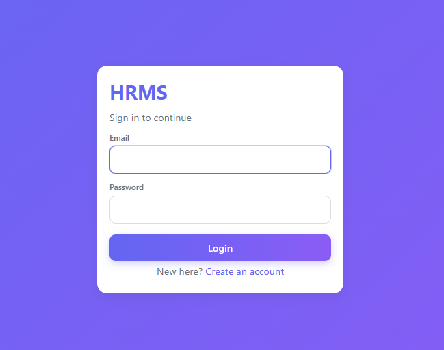
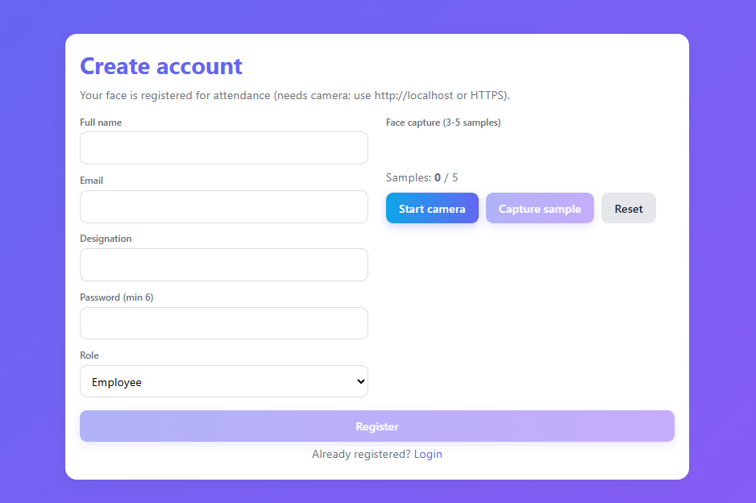
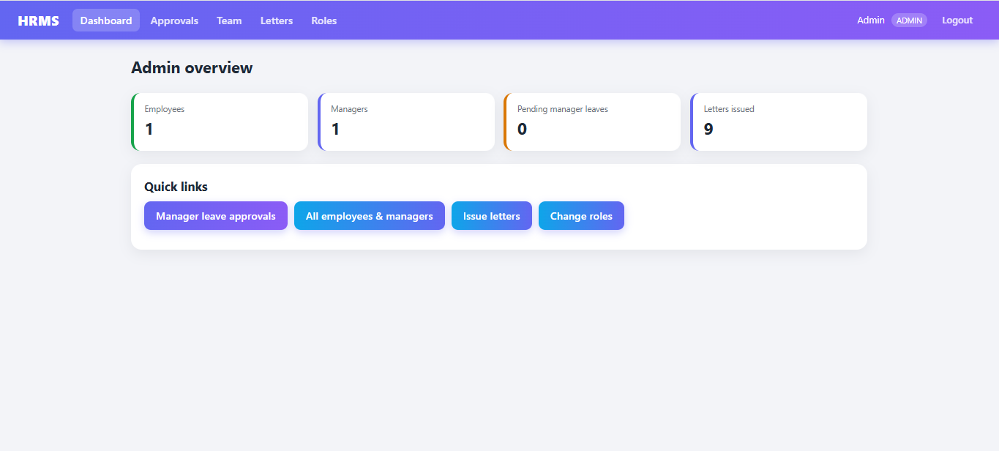
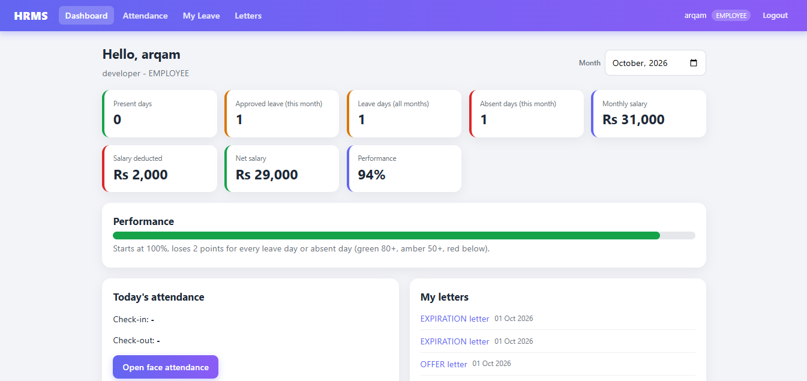
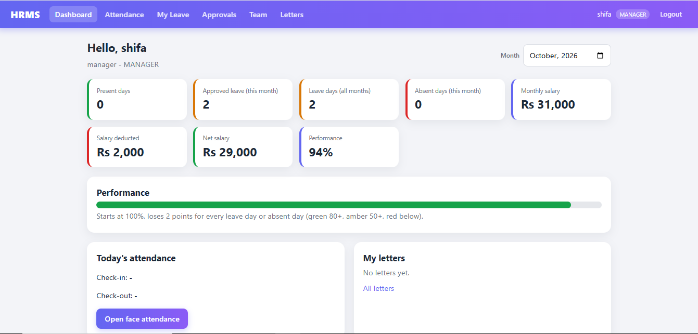
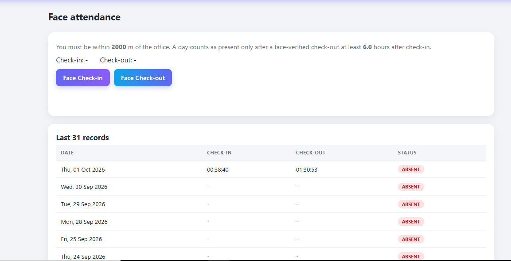
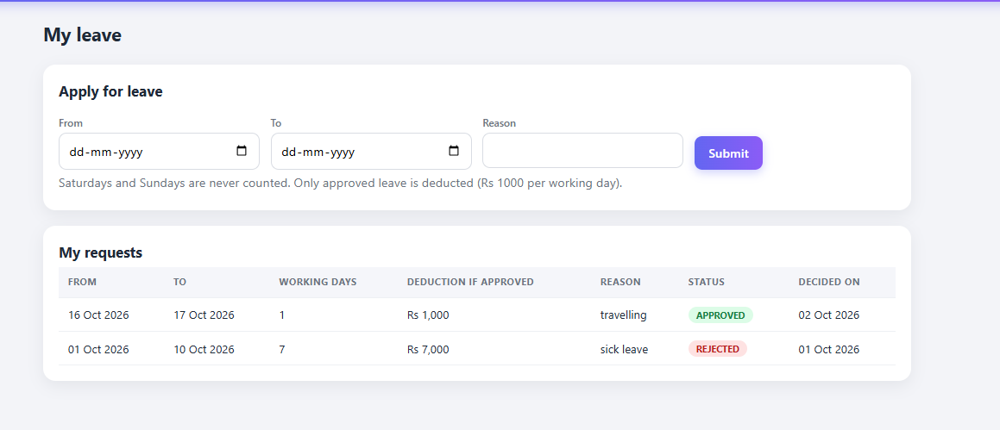
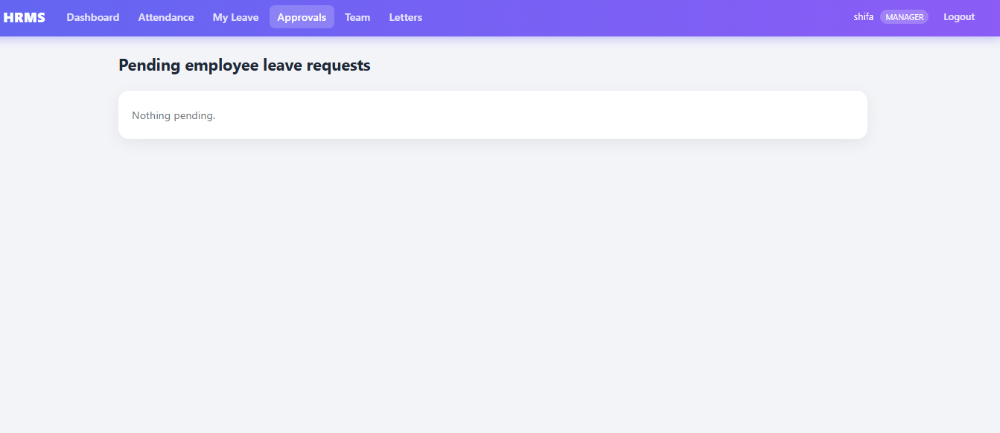
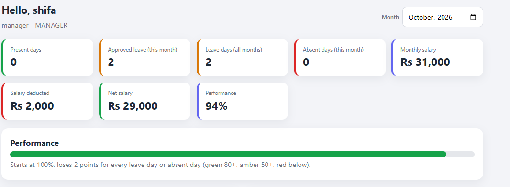
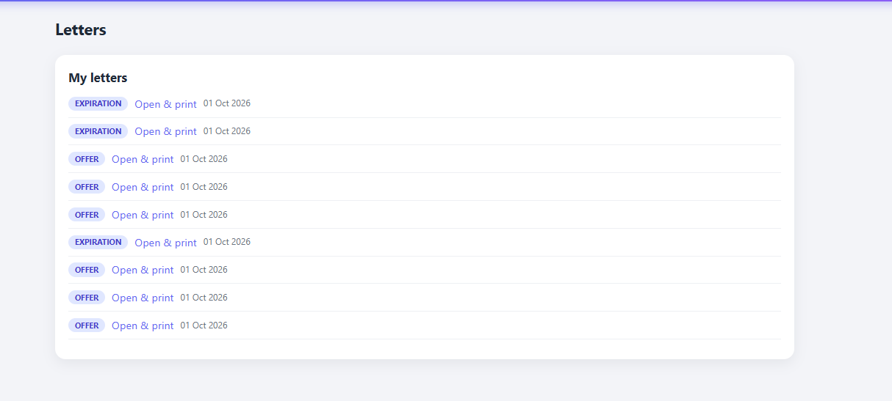

# HRMS - Human Resource Management System

A full-stack Human Resource Management System developed using **Java, Spring Boot, Thymeleaf and PostgreSQL**.

The system provides employee management, attendance tracking, leave management, payroll calculation, performance tracking and employee letter management.

---

## 🚀 Features

* Employee Registration and Login
* Admin Login
* Manager Login
* Role-based access
* Employee Dashboard
* Manager Dashboard
* Admin Dashboard
* Face Recognition Attendance
* Check-in and Check-out
* Working Hours Calculation
* Automatic Absent Tracking
* Leave Application
* Manager Leave Approval/Rejection
* Leave Balance Tracking
* Payroll Calculation
* Salary Deduction for Absence
* Approved Leave Handling
* Employee Performance Calculation
* Offer Letter
* Experience Letter
* Expiration/Leaving Letter
* Team/Employee Management
* Logout
* PostgreSQL Database

---

## 🛠️ Technologies Used

### Backend

* Java 17
* Spring Boot
* Spring MVC
* Spring Data JPA
* Spring Security
* Maven

### Frontend

* HTML
* CSS
* JavaScript
* Thymeleaf

### Database

* PostgreSQL

### Other Technologies

* Git
* GitHub
* Face Recognition
* OpenCV

---

## 📋 HRMS Modules

### Admin

The administrator can:

* Manage employees
* Manage managers
* View system statistics
* Manage employee information
* View letters
* Monitor the HRMS system

### Employee

Employees can:

* Login/Register
* View dashboard
* Mark attendance
* Check attendance status
* Apply for leave
* View leave status
* View salary information
* View performance
* View employee letters

### Manager

Managers can:

* View team members
* View employee attendance
* Review leave requests
* Approve leave
* Reject leave
* Monitor employee performance

---

## ⏰ Attendance System

The attendance module supports:

* Face recognition
* Check-in
* Check-out
* Working hours calculation
* Automatic absent tracking

A working day is considered **Monday to Friday**.

Saturday and Sunday are excluded from working-day calculations.

An employee is considered present when:

* Check-in is recorded
* Check-out is recorded
* Minimum required working hours are completed

If there is no valid attendance for a past working day, the day is counted as absent unless the employee has approved leave.

---

## 🏖️ Leave Management

Employees can submit leave requests.

The workflow is:

```text
Employee
   ↓
Apply Leave
   ↓
Manager
   ↓
Approve / Reject
   ↓
Employee Leave Status
```

Approved leave is not treated as absence.

---

## 💰 Payroll

The payroll module calculates salary based on working days.

The system supports:

* Daily salary rate
* Working-day calculation
* Absence deduction
* Approved leave handling
* Net salary calculation

Weekends are excluded from working-day calculations.

---

## 📊 Performance Tracking

Employee performance starts from 100%.

Performance points are adjusted based on leave and absence according to the configured HRMS rules.

---

## 📄 Employee Letters

The HRMS provides employee letter management including:

* Offer Letter
* Experience Letter
* Leaving/Expiration Letter

---

# 📸 Screenshots

## Login



---

## Register



---

## Admin Dashboard



---

## Employee Dashboard



---

## Manager Dashboard



---

## Attendance



---

## Leave Request



---

## Leave Approval



---

## Payroll



---

## Employee Letters



---

# ⚙️ Installation

## 1. Clone the repository

```bash
git clone https://github.com/YOUR_USERNAME/HRMS-Face-Recognition.git
```

## 2. Navigate to the project

```bash
cd HRMS-Face-Recognition
```

## 3. Configure PostgreSQL

Create an empty PostgreSQL database named (tables are created automatically):

```text
hrms
```

Update the database configuration in:

```text
src/main/resources/application.properties
```

## 4. Build the project

```bash
mvn clean install
```

## 5. Run the application

```bash
mvn spring-boot:run
```

The application will run on:

```text
http://localhost:8080
```

---

# 🔐 Security

Sensitive credentials such as database passwords should be stored using environment variables and should not be committed to GitHub.

---

# 👨‍💻 Developer

**Naeem Shaikh**

Java Developer | Java Full Stack Developer

---

## 📌 Project Status

**Completed**

The project is ready for demonstration and deployment.
